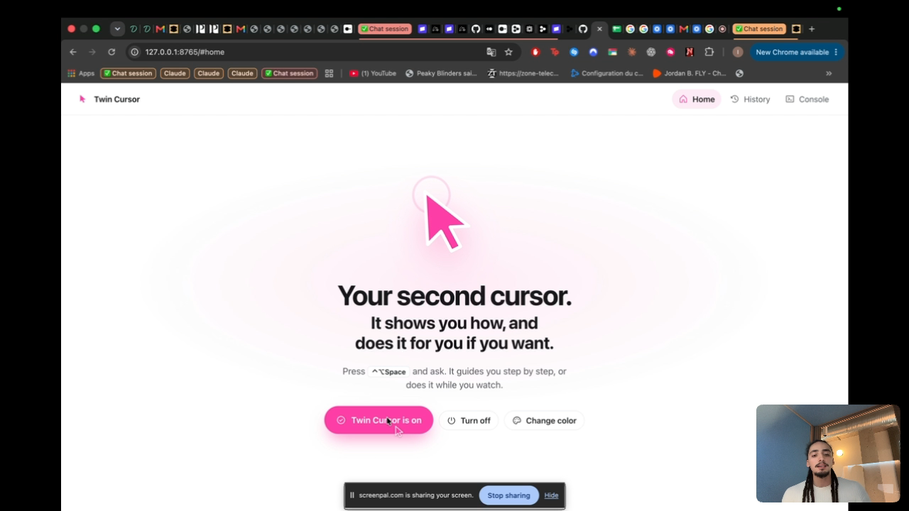
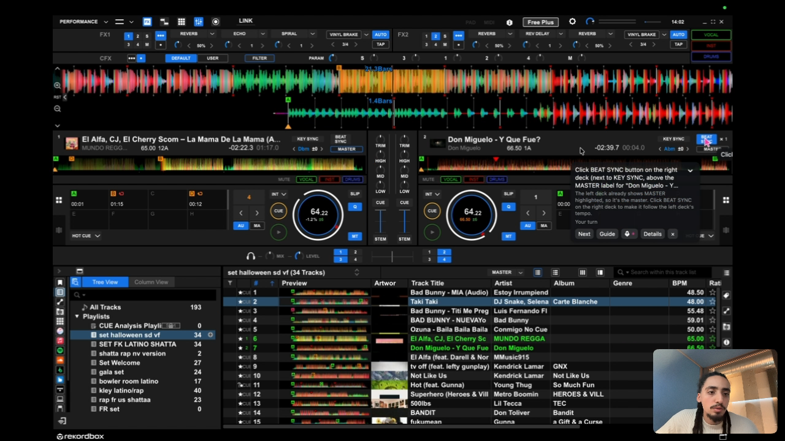
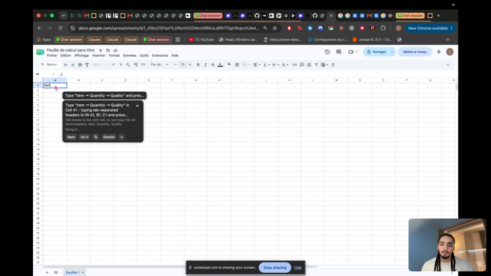
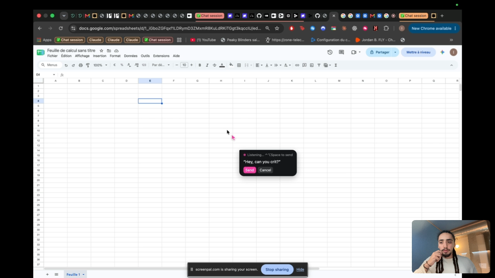

# Twin Cursor

**Your second cursor. It shows you how, and does it for you if you want.**

Twin Cursor is a pink second cursor for your Mac that makes complicated software easy. Press
**⌃⌥Space** and say what you want. In **Guide** mode the pink cursor points at the exact button in
any app, a voice explains each step, and it waits for you to click. In **Do it** mode it does the
clicks itself while explaining out loud, so you still learn.

Built in 2 days for the **H Company × 42AI Computer Use Agents Hackathon** (Paris, Nov 7–8, 2026).

- **Try it live:** https://01a1ba29-1725-7969-bc8e-a4b8b4e2de94-8080.eur-1.aiven.app (Mac with Apple chip, Chrome)
- **Demo video:** 2 minutes, Google Sheets (Do it) and rekordbox (Guide)



## What it does

| Guide: it teaches you | Do it: it does it for you |
|---|---|
|  |  |
| *"Show me where to click to match the BPM of these two songs."* The cursor lands on **BEAT SYNC** in rekordbox, a pro DJ app, and waits for you. | *"Create a table with Item, Quantity and Quality."* It clicks A1 and types the headers, explaining each move. |

- **Any app, not just the browser:** Google Sheets, Wikipedia, macOS System Settings, rekordbox…
- **Voice first:** you talk, it listens live, and it answers with a natural voice.
- **Gets better with use:** after each task it saves short lessons per app (Google Sheets, rekordbox…),
  in the background, so repeated tasks get faster.
- **You stay in control:** **⌃⌥X** stops it instantly. In Do it it never clicks delete / don't save, never
  touches passwords, macOS permission prompts or security settings, never types in the address bar, and
  stays in the task's app.



## How it works

```
 you speak ──► Gladia (live speech-to-text) ──► OpenAI (what do you want? guide or do?)
                                                   │
                Linkup (how do people do this?) ◄──┤
                                                   ▼
 screenshot ──► H Company Holo: plan the next step ──► Holo: point at the exact pixel
                                                   │
                     pink cursor moves there + OpenAI voice explains
                     Guide: you click   ·   Do it: Twin Cursor clicks
                                                   │
                                     new screenshot, next step…
```

## Sponsor and partner technologies we use

| Technology | What it does in Twin Cursor |
|---|---|
| **H Company: Holo** (`holo4-27b`, Models API) | The core. Looks at each screenshot, decides the next step, and points at the exact pixel to click (pointing on a zoomed crop for precision). Hedged requests keep steps at 1–3 s |
| **Gladia** (live speech-to-text) | Always-open mic during a task, real-time transcription with a custom vocabulary (rekordbox, BPM, Twin Cursor…), and it ignores Twin Cursor's own voice |
| **Linkup** (web search API) | Before the first click, fetches the known how-to path for this exact app and task, and builds per-app cheat sheets |
| **Aiven** (application + Postgres) | Hosts the jury website and the Mac app download, and keeps all API keys server-side behind a small proxy (`server/proxy.py`). The app on your Mac holds no keys |
| **Devin** (Cognition) | Coding teammate: built the Electron overlay and billing via pull requests, reviewed the deploy plan and the final code before the demo |
| **Stripe** (test mode) | A "Pro" paywall exists in the code (`brain/billing.py`), switched off for the jury |
| **OpenAI** | Intent routing (`gpt-5.4-mini`) and the spoken voice (`gpt-4o-mini-tts`, voice "sage") |

## Architecture

| Part | Where | What |
|---|---|---|
| Brain | `brain/` (Python, aiohttp) | The task loop: see → plan → point → speak → act/watch. Mouse and keyboard through macOS Quartz, window titles through Accessibility |
| Overlay | `overlay/` (Electron) | Transparent, click-through window over every app that draws the pink cursor, the step card and the listening bubble |
| Home page | `brain/static/index.html` | "Get your Twin Cursor", color picker, history of past tasks, console |
| Cloud | `server/` (Aiven) | Website, download, key proxy with a daily cap |
| Mac app | `scripts/build-mac.sh` | PyInstaller-frozen brain + Electron → `Twin Cursor.dmg` (Apple Silicon, ad-hoc signed) |

Decisions and their reasons: [DECISIONS.md](DECISIONS.md). Full plan: [PLAN.md](PLAN.md).
Test reports: [docs/test-reports/](docs/test-reports/).

## Try it (jury)

1. Open the live link in **Chrome** and click **Get your Twin Cursor**.
2. First time: download the app, drag it to Applications, open it (System Settings › Privacy & Security ›
   **Open Anyway** if macOS blocks it), allow Microphone, Accessibility and Screen Recording, then reopen it.
3. If Chrome asks to let the site use apps on this device, click **Allow**. The pink cursor flies to your mouse.
4. Press **⌃⌥Space** and ask, e.g. *"Show me how to add up 4, 8 and 15 in column A with a SUM formula."*

## Run from source (developers)

```bash
cp .env.example .env   # add HAI_API_KEY, GLADIA_API_KEY, LINKUP_API_KEY, OPENAI_API_KEY
python3 -m venv .venv && .venv/bin/pip install -r requirements.txt
(cd overlay && npm install)
./start.sh             # brain + overlay; control page on http://127.0.0.1:8765
```

macOS asks for Screen Recording, Accessibility and Microphone for the app that runs it.
Build the jury app with `scripts/build-mac.sh`.

## Team

Ismail El Hammoumi, with Devin (Cognition) building the overlay and reviewing the code.
